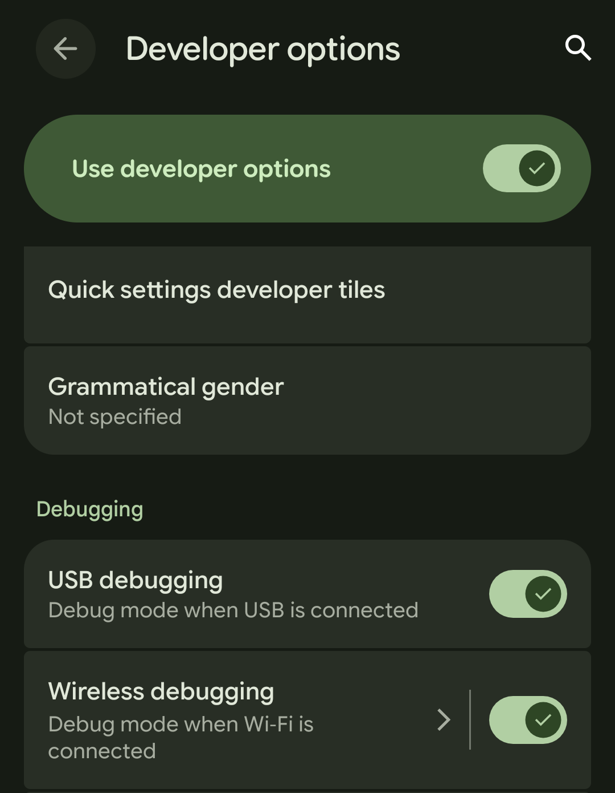
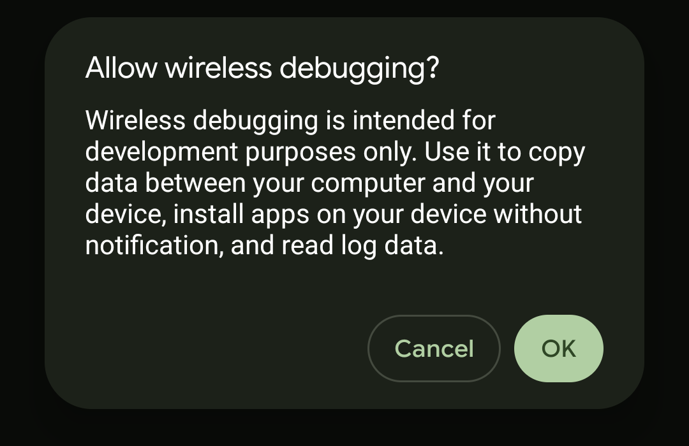
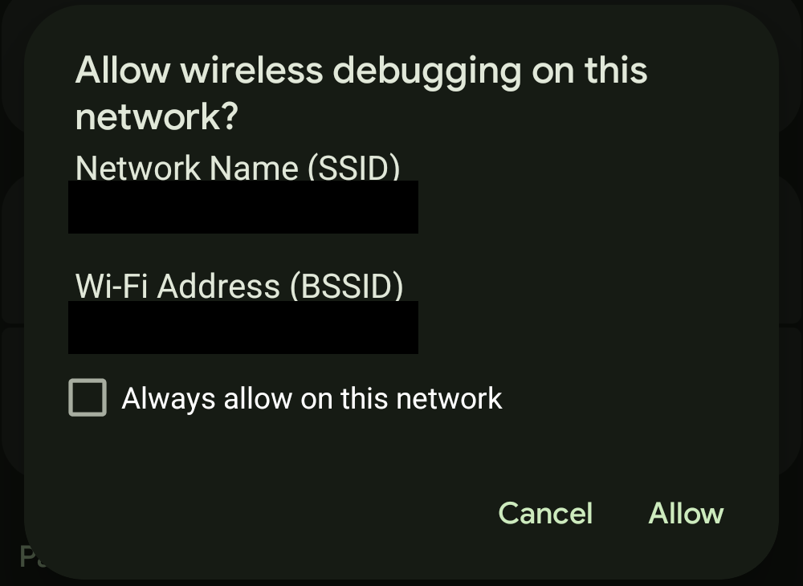
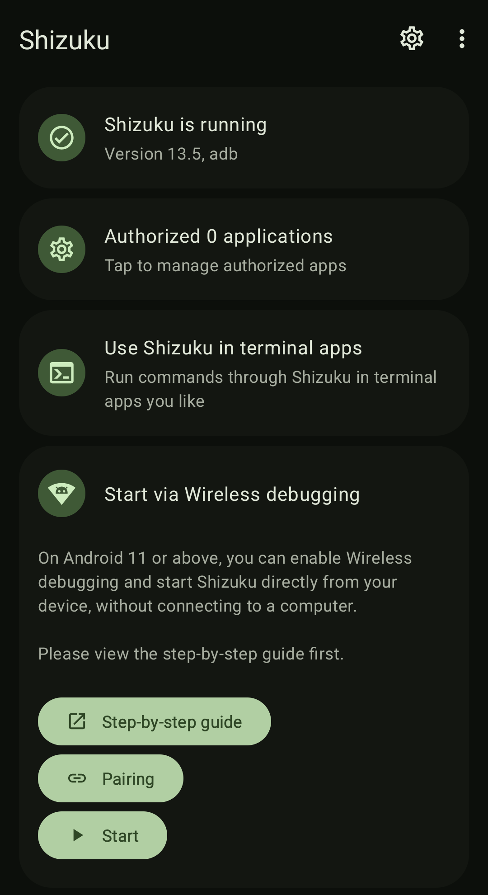
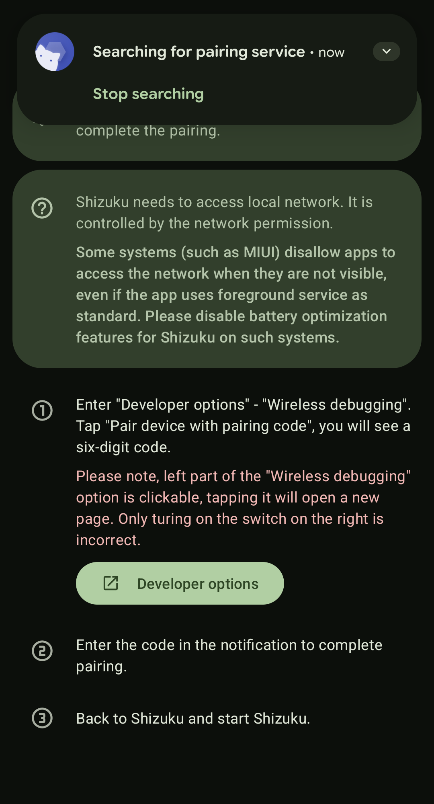
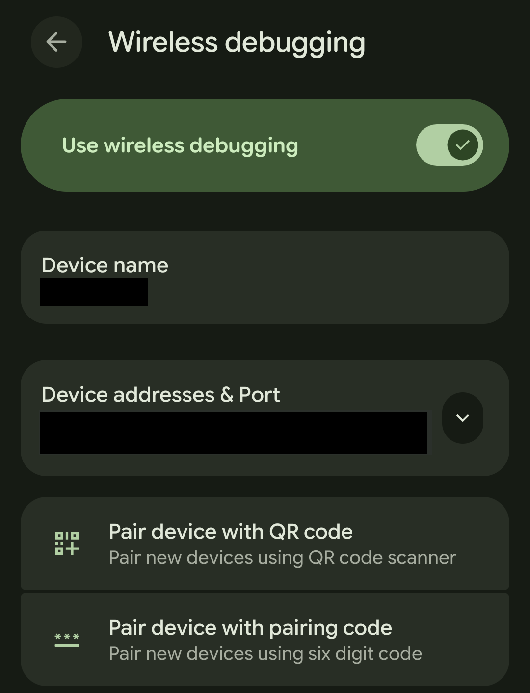
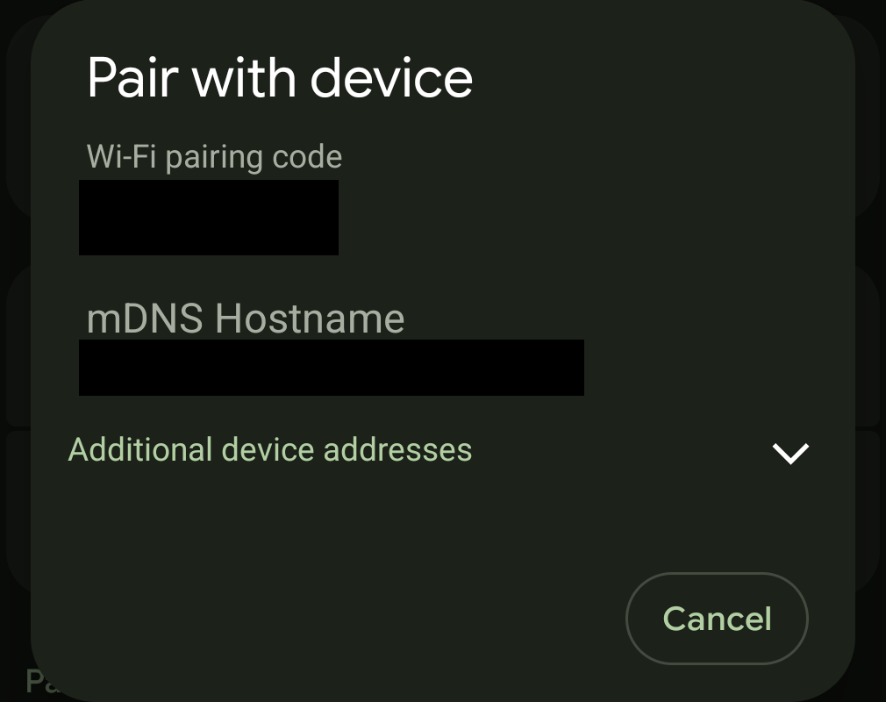
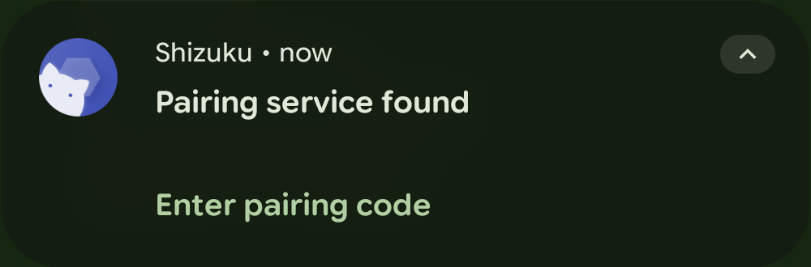
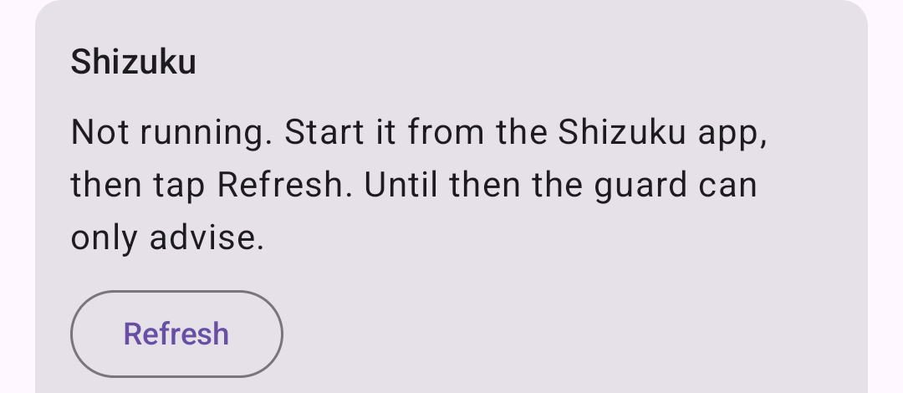

# CI Android Connection Doctor

An unofficial Android helper that gets phone audio streaming (ASHA) to a Cochlear Nucleus or Kanso sound processor back within seconds after Bluetooth drops, plus one-tap hand-off to another device. With **Start when the processor connects** on, it starts by itself when the processor comes back and stops once streaming holds.

> [!WARNING]
> This app is not made by, affiliated with or endorsed by Cochlear Ltd. It is not a medical device. Use it at your own risk; it never replaces your clinic, your audiologist or the official Cochlear app.

## Why it exists
After a Bluetooth drop (out of range, Bluetooth toggled, a reboot), Android reconnects ASHA on its own, and the processor drops every one of those connections until the official Cochlear app (Nucleus Smart) has set up its link first. Streaming can take minutes to come back, or never does.

The guard watches the link. When streaming drops, it pauses ASHA so it stops racing the official app, restarts the official app if its link is missing, waits for that link to hold, then resumes ASHA and checks that streaming stays up. On a Pixel 8, streaming is usually back 10 to 20 seconds after the link to the processor returns, and up to about 30 seconds when the link keeps dropping on the way back.

It manages the Bluetooth link only. It never changes volume, program or audio source, and never taps anything in the official app.

## Compatibility
- Android 12 or newer (minSdk 31)
- A processor that streams straight to Android over ASHA, and that the official Nucleus Smart app controls: Nucleus 7, Nucleus 8 or Kanso 2.
- Not for older processors such as the Nucleus 6 or the first Kanso. They have no phone Bluetooth: audio reaches them through the Phone Clip or Mini Mic, which Android reconnects as an ordinary headset, so the race this app fixes never happens.
- Tested on: Pixel 8, Android 17, with one Nucleus/Kanso-family processor: Bluetooth off and on, walking out of range and back, the processor switched off, a phone restart, and hand-off. Reports from other phones and processors are welcome.
- The official Nucleus Smart app must stay installed and paired with the processor: the guard relies on it to set up the link.

## Setup
1. Install [Shizuku](https://shizuku.rikka.app/), then pair and start it (see [Starting Shizuku without a computer](#starting-shizuku-without-a-computer)). Pausing and resuming ASHA needs `BLUETOOTH_PRIVILEGED`, which ordinary apps can't hold; Shizuku lends the app adb-shell rights for those calls.
2. Open this app, allow Bluetooth and notifications, then tap **Grant permission** under Shizuku.
3. Pick your processor under **Sound processor**.
4. Tap **Start guard**. A notification stays up while it runs, with **Hand off** and **Stop**.
5. Optionally, turn on **Start when the processor connects**. Android asks once to link the app to the processor; then the guard starts by itself whenever the processor connects, even with the app closed. After a phone restart this starts working once you unlock the phone.

The guard stops by itself, and its notification goes away, once streaming has held for 10 seconds, or after a minute with no link to the processor. While handed off, it keeps running so **Back to phone** stays in the notification.

Shizuku stops whenever the phone reboots. Start it again after every reboot, or the guard can't act. With **Start the guard at boot** on, the guard comes up by itself after a reboot. While the guard is running, it notices Shizuku coming back within a second. Otherwise, once Shizuku is running again, tap **Refresh** in this app.

## Starting Shizuku without a computer
On Android 11 or newer, Shizuku pairs and starts on the phone itself through wireless debugging. No computer or USB cable is needed.

The app walks you through the same steps: tap **Show steps** on the Shizuku card. It ticks off each step it can check (Shizuku installed, Wi-Fi joined, wireless debugging on, Shizuku running, permission granted) and opens the right screen for the next one. It opens by itself the first time, while Shizuku isn't installed.

Wireless debugging needs the phone connected to a Wi-Fi network, but any network works, even one with no internet: Shizuku only talks to the phone itself. A café or shop network is fine, and you can ignore its sign-in page. The phone's own hotspot doesn't count, because the phone has to be connected to Wi-Fi, not sharing it.

**Once, the first time:**
1. Turn on Developer options: Settings > About phone, tap **Build number** seven times.

   
2. Join any Wi-Fi network.
3. Open Settings > System > Developer options and tap the words **Wireless debugging**, not only its switch, to open its page.

   
4. Turn on **Use wireless debugging**. Tap **OK** on "Allow wireless debugging?", then **Allow** on "Allow wireless debugging on this network?".

   
   
5. Open Shizuku and tap **Pairing** under "Start via Wireless debugging". Shizuku shows its own pairing steps.

   
   
6. Go back to the Wireless debugging page and tap **Pair device with pairing code**. Leave the code on screen.

   
   
7. Pull down the notifications. Shizuku's says "Pairing service found": tap **Enter pairing code** and type the six digits.

   
8. In Shizuku, tap **Start**. Then open this app and tap **Grant permission** under Shizuku.

**After every restart:**
1. Join any Wi-Fi network.
2. Turn on Wireless debugging, and tap **Allow** if it asks about this network.
3. Open Shizuku and tap **Start** under "Start via Wireless debugging".
4. Open this app and tap **Refresh**. The Shizuku card changes from "Not running" to "Ready".

   
   
5. Turn Wireless debugging off and leave the Wi-Fi if you like. Shizuku keeps running until the next restart.

Don't turn off USB debugging or Developer options while you rely on the guard: that stops Shizuku.

Tip: Settings > System > Developer options > Quick settings developer tiles > **Wireless debugging** adds a Quick Settings tile that turns it on in one tap.

With a USB cable and a computer, `adb shell` can start Shizuku with no Wi-Fi at all (see the Shizuku app for the command).

## Without Shizuku
The guard still runs without Shizuku, but it can only watch and advise, because pausing streaming needs Shizuku. When streaming drops, a notification says what to do:
- **Streaming didn't reconnect:** the processor is linked but streaming isn't trying. The notification opens the processor's Bluetooth page; tap **Connect**.
- **Streaming keeps failing:** Android keeps connecting before Nucleus Smart, and nothing in Settings can stop that: **Connect** and reopening Nucleus Smart won't help. Start Shizuku and the guard picks it up within a second and fixes it.
- **Streaming is switched off:** the guard had paused streaming and lost Shizuku before it could switch it back on. Start Shizuku and the guard picks it up within a second and switches streaming back on.

## Hand-off
**Hand off** pauses ASHA and stops the official app so another device (a laptop, say) can take the processor. **Back to phone** restarts the official app's link and resumes ASHA.

## Troubleshooting
- **Set the official Cochlear app's battery usage to Unrestricted** (Settings > Apps > the Cochlear app > App battery usage). Many dropouts stop with that alone. Do the same for this app.
- **Streaming stays off after a reboot.** When you restart the phone, a running guard switches streaming back on just before it shuts down. If the phone went down without that (a crash, a dead battery, or the guard stopped during a hand-off), streaming stays off, and a notification says so. Settings can't switch it back on: **Connect** on the processor's page skips a paused profile. Start Shizuku, then start the guard, and it switches streaming back on. If the app or Shizuku dies while streaming is paused, streaming is switched back on by itself. Stopping the guard while Shizuku isn't running can't switch it back on either; a notification says so.
- **The Shizuku card says "Not running".** Shizuku stopped, usually after a reboot. Start it again, then tap **Refresh**.
- **The guard didn't start by itself after a restart.** Android can't wake the app until the phone has been unlocked once. Once you unlock it, the guard starts if the processor is connected, or the next time it connects.
- **The official app pops up on screen.** Restarting it is how the guard gets its link back; it currently brings the app to the foreground.

## Limitations
- Needs Shizuku to fix anything, and Shizuku needs wireless debugging (Wi-Fi) or a USB cable after every reboot. Without it the guard only advises.
- Only one processor is guarded at a time.
- The fix belongs in the processor firmware or the official app; this app works around it from the outside.

## Reporting a bug
Open an issue with the **Bug report** form, or the **Device report** form to say how it works on your phone and processor. A bug report needs your phone model, Android version, processor model, and the guard's log. The log is shown in the app under **Event log**, or with adb:

```bash
adb logcat -d -s AshaGuard
```

## Modules
- `:core:asha`: pure-JVM recovery state machine (unit-tested)
- `:app`: Compose UI, foreground guard service, Shizuku user service for the privileged calls

## Build
```bash
./gradlew :core:asha:test :app:assembleDebug
```
Requires JDK 17+ and the Android SDK (see `local.properties` or `ANDROID_HOME`).

A release build is signed when `RELEASE_KEYSTORE_PATH`, `RELEASE_KEYSTORE_PASSWORD`, `RELEASE_KEY_ALIAS` and `RELEASE_KEY_PASSWORD` are set, and unsigned otherwise. Pushing a `v<versionName>` tag runs `.github/workflows/release.yml`, which builds the signed APK and attaches it to a GitHub release. A tag pushed before those four Actions secrets exist fails the release instead of publishing an unsigned APK.

## Reproducible builds
The release APK builds byte-for-byte the same on any machine, so anyone can check that a published APK came from this source. Build the tag unsigned with JDK 17 and the Android SDK (build-tools 34.0.0), then compare it with the release APK, ignoring the signature, using [apksigcopier](https://github.com/obfusk/apksigcopier):

```bash
git checkout v<version>
./gradlew --no-daemon :app:assembleRelease
apksigcopier compare <release>.apk --unsigned app/build/outputs/apk/release/app-release-unsigned.apk
```

`apksigcopier` needs `apksigner` from the SDK build-tools on `PATH`.

## License
GPL-3.0-or-later. See [LICENSE](LICENSE).
